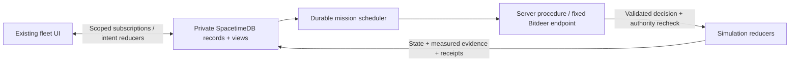

# Production architecture: Maincloud fleet

The production application is the existing fleet frontend, a Rust SpacetimeDB 2.13.0
module on Maincloud, and Bitdeer inference invoked by server-side procedures. It is a
synthetic drone simulation. It does **not** send the HTTP scenario suite's attack requests,
control aircraft, or demonstrate host resource exhaustion. Static frontend hosting holds
presentation assets and scoped demo credentials, never the provider key.

## Responsibilities and trust

| Component | Authority |
| --- | --- |
| Frontend (`web/maincloud-chat.ts`, `web/fleet.ts`) | Presents subscribed state; submits messages, stop, new chat and defender reset. Cannot declare success. |
| Bitdeer | Plans assignments, interprets observations and chooses next actions. Its short explanations are unverified statements. |
| Orchestration (`maincloud.rs`, `backend.rs`) | Assignments, schedules, cumulative budgets, reservations, cancellation and mission lifecycle. |
| Simulation (`fleet.rs`, `battle.rs`) | Validates catalog actions, applies state changes, resolves fallible attempts and verifies completion conditions. |
| Database (`workflow.rs` and private module tables) | Persists current work, ordered history, evidence, role grants and recovery state; server views enforce visibility. |

The browser never receives inference credentials, private prompts or unrestricted database
access. Procedures call one compiled Bitdeer HTTPS URL outside a database transaction.
A reservation transaction and a completion transaction surround that I/O. Completion
rechecks the original identity's grant, role, epoch, conversation, assignment, operation,
deadline and policy version. Provider errors/refusals stay failures; there is no fixture
fallback or alternate provider retry.

The hackathon uses **one shared arena, two operator workspaces and a read-only observer workspace**, not personal
accounts or tenant isolation. Overview's observer can request bounded GLM commentary on
current observations and the latest 64 evidence records. That fixed analysis request uses
the existing scheduler and grants no simulation mutations; server validation requires an
answer with no tasks and only supplied evidence IDs. Anyone offered the defender demo credential can reset the
shared arena. Publisher authority can deploy code and grant roles; protect that identity.
The legacy Node owner credential must not be operated concurrently as another scheduler.
No multitenancy, extra queue or microservice is introduced here.

## Authoritative records

All tables below are private. Public views are computed for the caller; adding indexes
does not make their source tables public.

| Record | Relationship and meaning |
| --- | --- |
| `fleet_session`, `backend_chat_session` | Current fleet epoch and each role's conversation generation. |
| `backend_chat_turn` | One deduplicated user request, explicit role/epoch/generation, processing state and bounded input/result. |
| `backend_chat` | Operation identity, request key, role/epoch/generation, terminal/current state and small mission metadata. Hosted `result` is empty after normalization. |
| `hosted_workflow` | One per hosted operation: original creation/deadline, replan count and whether its immutable completion contract is installed. |
| `hosted_assignment` | Individually addressable `(operation, agent)` assignment: explicit epoch/generation/role, goal, immutable candidate targets, current target and lifecycle. |
| `hosted_job`, `hosted_budget`, `hosted_alarm` | Bounded decision attempts, global inference reservations, cumulative calls and durable wakes/watchdogs. Jobs already had explicit operation/agent/epoch/generation and state/operation indexes before this change. |
| `battle_attempt` | Individually addressable action attempt with explicit operation, agent, epoch and stage; `(operation, agent)` links to its assignment. Sources/affected targets/reports are bounded simulation payloads. |
| `fleet_chat_action`, `fleet_evidence` | Idempotent action receipt and directly linked inserted evidence IDs, including paired denial/legitimate-control verification. |
| `hosted_record`, `backend_chat_transition`, `backend_chat_message` | Ordered mission history, operation transitions and explicitly scoped chat history. Historical worker transitions explain a run; the typed assignment defines its current lifecycle. |
| `fleet_drone`, `battle_drone` | Current physical presentation state and synthetic security/participation state. |

`workflow.rs` reconstructs the old operation JSON shape for existing reducers and views.
It stores assignments/history separately and removes their mutable copies from the hosted
operation row in the same transaction. The frontend contract is preserved; the adapter
is not a second scheduler. The Node compatibility path keeps its original JSON storage.
Scope indexes on `(role, epoch, generation)` serve chat/operation queries. Current fleet
views select the current epoch, then enforce role filtering/redaction. No authorization
or hosted conversation membership depends on splitting a deduplication key.

## One mission

1. A granted operator sends a bounded prompt with epoch, conversation generation and an
   idempotency key. Repeating identical input reuses the request; conflicting input fails.
2. A durable turn/job/alarm queues planning. A short transaction reserves one of four
   global inference slots. Bitdeer proposes one to four specialists; reducers validate
   catalog goals, target scopes, identities, names and budgets before deployment.
3. Typed assignments hold the immutable completion contracts and current worker state.
   Each specialist observes scoped state, teammates and measured receipts, then chooses
   one permitted action. Required discovery is server observation without a model call.
4. The reducer checks assignment, sequence and policy and inserts one action receipt.
   Scheduled simulation attempts may succeed, partially affect the target, or be resisted.
   Event insertion returns its ID directly; receipts never search for a maximum ID.
5. Specialists reassess, wait, hand off evidence or retarget inside their original scope.
   There are at most eight decisions per specialist, 33 total model calls including the
   planner, two replans and 75 seconds from the original request. Movement is independent.
6. Completion rechecks all required simulation predicates, records each verified condition
   and persists a truthful terminal summary. An accepted command, animation tick, provider
   reply or model explanation cannot by itself establish mission success.

## Failure, cancellation, reset and reconnect

A 30-second conversation deadline and 20-second provider timeout bound inference. Running
HTTP cannot be cancelled: its reservation/watchdog remains until return or timeout plus
one second of grace, even after cancellation or reset. Late results cannot mutate a new
epoch, conversation or terminal operation. Failed/refused/malformed inference is recorded
as execution failure, independently of the simulation outcome.

Stop cancels the caller's pending work. New chat cancels that role's work and increments
its generation. Defender reset increments the fleet epoch, rebuilds the current world,
clears current agents/discoveries and fences old effects. It now retains terminal jobs,
action receipts, attempts, budgets and evidence needed to explain old missions. Historical
attempts are closed before current simulation tables are rebuilt. Current-session views
hide those old records. These are deliberate resets of simulation state, not deployment
schema migrations.

Schedules and reservations are database records. Database restart preserves pending work;
the next deferred effect rechecks authority. A reconnect receives a fresh subscription
snapshot from Maincloud and reconstructs chat/operations from durable records without
executing actions again. Disconnected clients report disconnection and keep their last
observations; no browser timer manufactures outcomes.

## Retention and metrics

Hosted admission has a lifetime cap of **200 turns per role per database**, across resets
and new chats. Deduplication rows remain for that entire lifetime. This bounds production
mission history to at most 400 operations, 1,600 assignments, 14,000 jobs and 12,800 action
attempts; many turns only answer questions. Each mission has at most 512 history records. Up to 200 additional observer analyses can
retain one turn/job each, without operations, assignments or action attempts.
Provider HTTP response envelopes are never stored. Metrics retain configured and reported
model, finish reason, latency and available numeric token counts; missing usage stays unknown.
Terminal jobs clear request bodies,
while compact validated decisions/errors and inference metrics remain private history.
Active requests keep their input until completion/timeout. Alarm cleanup is per operation;
reset cancels indexed queued/waiting/attempt jobs while retaining running reservations.

This is a bounded demo database, not an unattended retention service. At admission capacity
an operator must export/archive and review the next database transition; time-based archival
and deletion are not implemented. Never delete active work or retry/deduplication records
to bypass that cap. Owner-run historical fixtures are outside hosted admission limits.

Movement is `fleet_drone.tick`. Attempted actions are persisted receipts/attempts; accepted
unauthorized commands are corresponding status-200 evidence; verified outcomes are server
completion predicates and paired verification evidence. Movement no longer increments
`commands`. Existing pre-upgrade `commands` values may contain old movement counts and
are preserved: do not use that column as a historical success metric. The UI's outcome
presentation uses evidence and mission verification, not that counter.

Movement still schedules one independent timer per drone (180–300 ms by ID). Independent
inference and frontend interpolation are unchanged. See [database validation and migration](DATABASE_DESIGN.md)
for measurements, their limits and the concrete upgrade procedure. Database query work
alone does not establish a viewport frame-rate improvement.

## Current, legacy and future

- **Current production fleet:** this path; setup and bounded model-loop details in
  [MAINCLOUD.md](MAINCLOUD.md). The six-drone resilience fixture is a separate simulation
  mode within the module, not production model evidence.
- **Owned HTTP scenario suite:** [HTTP_ARCHITECTURE.md](HTTP_ARCHITECTURE.md), governed by
  [TARGET_SPEC.md](TARGET_SPEC.md). It issues real requests to its own practice service
  and has separate credentials, referee probes, tests and evidence.
- **Legacy Node fleet runtime:** [FLEET_CHAT_API.md](FLEET_CHAT_API.md), retains its leased
  owner scheduler and compatibility reducers. It is not in the Maincloud browser path.
- **Historical prototypes:** `arena/`, scripted timelines and recorded report views do
  not authorize production outcomes. Sanitized HTTP publisher tables are separate from
  fleet evidence even though their module packaging is shared.
- **Future:** unattended archival, representative hosted/GPU profiling and any scheduling
  change supported by that profiling. No claim of real attacks, aircraft integration,
  statistical security or per-user tenant isolation follows from this simulation.

The [2026-10-25 end-to-end audit](AUDIT_2026-10-25.md) records the current fixes,
real-provider local evidence, measurements and remaining production rollout steps.
