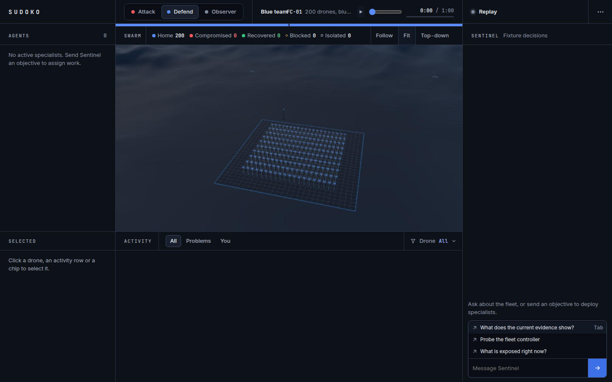
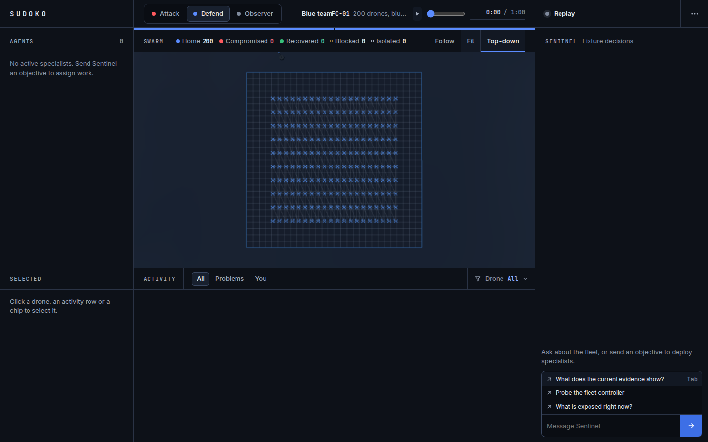

# Square formation validation — 2026-10-25

The fleet default is `shared/fleet.json:drones`; the same file defines columns,
spacing and the separate permitted maximum. Rust generates compile-time constants
from this source, and TypeScript imports it. No client total is inferred from a
constant: header, possession and legend totals use scoped drone rows.

The default 200 drones occupy 20 columns and 10 rows. Each axis spans 114 m;
horizontal spacing is 6 m and vertical spacing is 114/9 m. These are evenly spaced
rows and columns across a square footprint, rather than equal distances between both
axes. The operating grid itself is 168 × 168 m in the clean fixture, centered at the
scene origin. Healthy altitude and figure-eight movement are shared; drone IDs retain
stable slots. Recovery glides into the original slot. The old crescent/scatter/positional
waves are removed. Compromised model attitude remains decorative.

## Checks run

All requested commands passed:

- `npm run spacetime:build`
- `npm run spacetime:bindings` (schema unchanged; regenerated bindings match existing output)
- `npm run typecheck`
- `npm run build:fleet`
- `SPACETIME_BINARY=/path/to/spacetimedb-standalone npm run test:fleet`
- `SPACETIME_BINARY=/path/to/spacetimedb-standalone npm test`: 60 tests, no failures or skips.

Also passed: `cargo test --manifest-path arena-live/Cargo.toml` (11 tests),
`FLEET_MAINCLOUD_CONFIG=output/maincloud/fleet-config.json npm run build:vercel`,
`npm run export:fleet`, and `node scripts/check-fleet-formation.ts` with Playwright's
Chromium executable supplied through `PLAYWRIGHT_CHROMIUM_EXECUTABLE_PATH`.
The design detector reported no findings in the changed renderer files.

`test:fleet` creates a real isolated database and records 200 drone rows per full-role
frame, including movement, takeover, verified recovery, hardened blocking and private
view checks. It then records a clean reducer snapshot in `output/fleet/formation.json`.
Every clean Rust slot is checked against the shared TypeScript slot calculation.
The browser check uses that measured snapshot; it does not invent drone outcomes.
Small four-/six-/32-drone fixtures in unit/integration tests remain deliberate isolated
scenarios, not application defaults. Dated historical performance reports retain their
original measured counts. Runtime decision budgets, camera coordinates and frame-window
lengths containing the number 120 are unrelated to fleet size and remain unchanged.

## Screenshots

Both are Defend at 1440 × 900, with the actual Three.js WebGL scene. Browser checks
assert square pad dimensions, origin centering, all pad corners in the frustum, all 200
instanced bodies, header and possession totals, and no page errors. Visual review
confirmed even rows/columns and the Home 200 legend. Reloading the replay and switching
roles preserve ID positions. Attack shows “Fleet size unknown” and no undiscovered rows.

## Performance and limits

A six-second sample on this Linux host used headless Chromium with ANGLE SwiftShader
software WebGL, all 200 drones visible, trails and links retained, and the existing
adaptive resolution controller. It measured 12.65 FPS, p95 frame interval 116.6 ms,
16 draw calls, 101,306 triangles and p95 synchronous draw submission 4.3 ms at DPR 0.75.
Bodies and shadows already use shared instanced meshes; stems, trails and links use
shared GPU buffers. No drones are hidden to improve performance.

This is not a MacBook Air benchmark and does not demonstrate 60 FPS. A hardware run on
the target MacBook Air remains required; set the Chromium executable to that machine's
browser and rerun the check. The sample uses a static measured replay, so it also does
not measure simultaneous live subscription/model inference load.

No production session was reset or module published for this PR. Publishing the new
module preserves an existing fleet's count and battle state. An operator must explicitly
start a new default-size session to replace the existing smaller fleet; that operation
clears battle and chat state. The initialization command in `MAINCLOUD.md` reads its
count from the shared setting.
